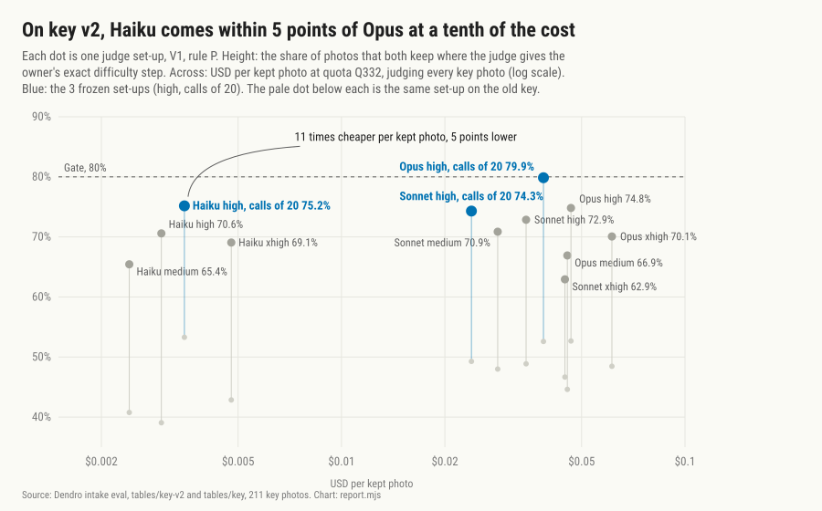

# Intake eval: report (draft)

Task 7 wrote this draft, with the key section only. Task 11 adds the held-out set, the decision rule, and the costs. Written by `report.mjs`.

## The key

### The result

- No judge set-up passes the fixed gates on the key, on the old labels (0 method rows) or on key v2 (0). The gates are drop recall 80%, keep agreement 85%, exact difficulty step 80%, and within one 97%.
- The owner's own labels move. On the 91 key photos that the owner relabelled blind, the old and the new label agree on keep for 89.0% of the photos and on the exact difficulty step for 48.1% of the 77 photos kept both times. On those photos the judges agree with the owner about as well as the owner agrees with the owner (NOTES.md, Task 7).
- Owner ruling 2026-10-27 (plan, "Rulings of 2026-10-27", item 4): freeze without a pass of the fixed gates. Task 11 judges the held-out run against the owner's own repeat agreement (`heldoutCheck`). No third prompt variant.
- **The freeze** (`frozen.json`): variant V1, rule P, calls of 20, Opus `high`, Sonnet `high`, Haiku `high`. The sha256 of `lib/step.mjs`, `briefs/judge-V1.md`, `lib/schemas.mjs` are in the file, and `freeze.mjs --check` tests them before the held-out run.

### Key v2

Key v2 is the owner's labels of 2026-10-11 with two later sets of calls on top (`lib/key-v2.mjs`). It is the key table of this report. The old key is next to it.

1. The examples sheet: the 49 photos where the 3 frozen set-ups agree with each other and not with the owner. The owner saw the judges' answers and chose "Judges are right" for 47, "My call stands" for 2, and "Could be either" for 0. Key v2 takes the judges' call for the first group.
2. The blind relabel: the other 91 photos where any frozen set-up differs from the owner. The page showed no earlier label and no judge answer, and a legend of the difficulty steps. 41 of 91 labels are the same as before.

Key v2 is not blind on the first group: on that sheet the owner saw the judges' answers. So key v2 can lean toward the judges on up to 47 photos. On the blind group, the judges agree with the new labels about as well as with the old ones (NOTES.md, Task 7).

### The set-ups

V1, rule P. Agreement is against key v2; "old key" is the exact difficulty step against the labels of 2026-10-11. Repeat: two runs of the same set-up agree on the exact difficulty step. USD per kept photo: method CR over all photos, quota Q332. The USD of the `medium` and `xhigh` set-ups is from one attempt of each job.

| set-up | exact, old key | exact, key v2 | keep | drop recall | within one | repeat, exact | USD per photo | USD per kept photo |
|---|---|---|---|---|---|---|---|---|
| Opus medium | 44.6% | 66.9% | 86.7% | 94.0% | 86.0% | - | USD 0.0224 | USD 0.0454 |
| Opus high | 52.7% | 74.8% | 87.7% | 92.0% | 90.6% | - | USD 0.0236 | USD 0.0466 |
| Opus xhigh | 48.5% | 70.1% | 86.3% | 90.0% | 90.5% | - | USD 0.0302 | USD 0.0613 |
| **Opus high, calls of 20 (frozen)** | 52.6% | 79.9% | 86.7% | 88.0% | 92.8% | 93.4% | USD 0.0193 | USD 0.0387 |
| Sonnet medium | 48.0% | 70.9% | 81.0% | 88.0% | 92.9% | - | USD 0.0131 | USD 0.0285 |
| Sonnet high | 48.9% | 72.9% | 88.6% | 94.0% | 90.7% | - | USD 0.0165 | USD 0.0345 |
| Sonnet xhigh | 46.7% | 62.9% | 89.1% | 90.0% | 86.7% | - | USD 0.0231 | USD 0.0447 |
| **Sonnet high, calls of 20 (frozen)** | 49.3% | 74.3% | 90.5% | 94.0% | 93.8% | 84.3% | USD 0.0119 | USD 0.0239 |
| Haiku medium | 40.8% | 65.4% | 84.4% | 84.0% | 89.7% | - | USD 0.0012 | USD 0.0024 |
| Haiku high | 39.1% | 70.6% | 86.3% | 92.0% | 87.5% | - | USD 0.0014 | USD 0.0030 |
| Haiku xhigh | 42.9% | 69.1% | 85.8% | 84.0% | 89.2% | - | USD 0.0024 | USD 0.0048 |
| **Haiku high, calls of 20 (frozen)** | 53.3% | 75.2% | 88.6% | 84.0% | 91.7% | 77.5% | USD 0.0018 | USD 0.0035 |

What the chart shows:

- Key v2 lifts every set-up by 16 to 32 points. Most of the gap on the old key was in the labels.
- Opus: calls of 20 give the best exact difficulty step, at the lowest USD per kept photo.
- Sonnet: calls of 20 give the best exact difficulty step, at the lowest USD per kept photo.
- Haiku: calls of 20 give the best exact difficulty step, but medium at calls of 10 (USD 0.0024) and high at calls of 10 (USD 0.0030) cost less per kept photo.
- More effort does not buy accuracy: `xhigh` is below `high` at calls of 10 for all 3 models, and costs more.
- Haiku, frozen, is 5 points below Opus, frozen, at 11 times less per kept photo. The decision rule (within 5 points, the cheapest wins) runs on the held-out set in Task 11, not here.

### Photo calls for the owner

- Thin-cell photos: none. No set-up row has a thin-cell photo.
- Species doubts: none. No answer has a `mismatch` escalation or a `hybrid` reject. So the review sheet of these photos had no photo.
- The owner's answers: `key/gate-examples.json` and `key/relabel.json`.

### Limits

- The key is small (211 photos, 21 cells), and the rule and the variant were chosen on it. The held-out set is the test.
- The 91 relabelled photos are the photos where a judge differed from the owner, so they are harder than a random sample. The owner's agreement with the owner on a random 40 comes in Task 10.
