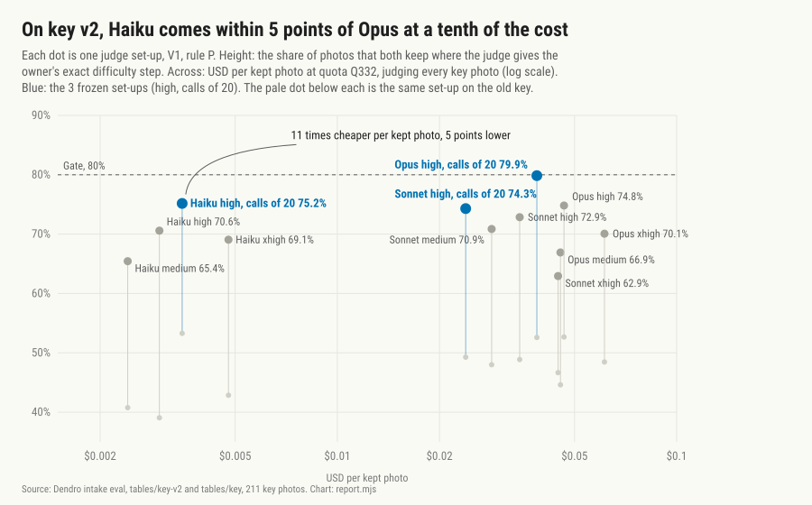
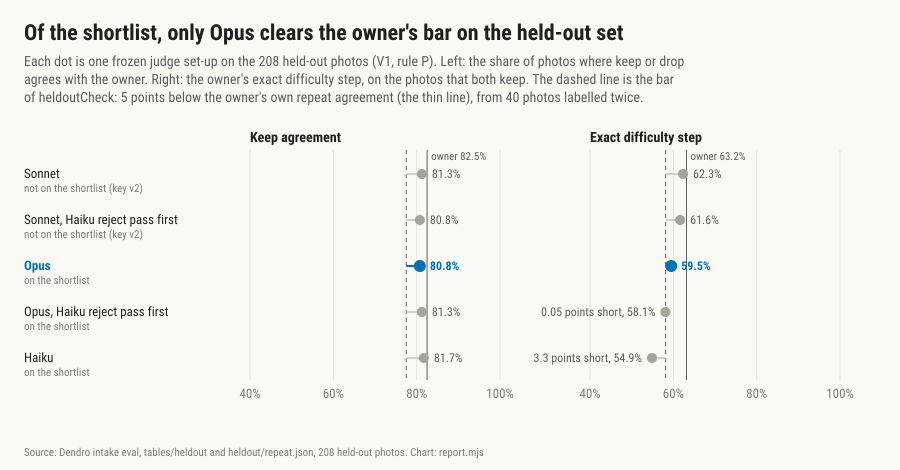

# Intake eval: report

The report of the intake eval, phases 1 to 3 (plan `docs/superpowers/plans/2026-10-21-intake-eval.md`). Written by `report.mjs` from the tables. The owner rules on the method; the decision record goes in `docs/decisions/`.

## The result

- **Owner ruling 2026-11-13: Sonnet FR** (`docs/decisions/2026-11-13-intake-method.md`). Haiku drops its rejects, Sonnet at `high` judges the rest, and a Sonnet agent ranks each cell. Of the 51 photos it picks for the Q332 quota on the held-out set, the owner kept 94.1%, and 64.7% are at the owner's difficulty step, at USD 0.0525 per kept photo. It fills 51.9% of the quota slots. The owner prefers too few photos to bad ones. This overrules the result of the decision rule below: Sonnet missed the shortlist on key v2, but passes `heldoutCheck` on the held-out set.
- **The decision rule gives Opus CR20**: Opus at `high` judges the first 20 photos of each species pool, and the code order picks the photos. On the held-out set it costs USD 0.0627 per kept photo, with keep 80.8% and exact difficulty step 59.5%, against a bar of 77.5% and 58.2%.
- **But it fills only 14.8% of the quota slots** (4 of 27), because it judges 60 of the 208 photos. The same set-up over all photos (Opus CRall) fills 59.3% at USD 0.0804 per kept photo. The rule ranks by USD per kept photo, and a small K keeps fewer photos for less. The owner rules on this.
- **Haiku fails the check** on the exact difficulty step: 54.9% against the bar of 58.2%, 3.3 points short. Its keep agreement passes (81.7%). Haiku costs USD 0.0055 per kept photo over all photos, 15 times less than Opus.
- **Sonnet is not on the shortlist**: on key v2 its exact difficulty step is 74.3%, below the line of 75.1% (5 points under the best, 80.1%). On the held-out set it passes the check (keep 81.3%, exact 62.3%) at USD 0.0562 per kept photo over all photos.
- **The owner's own bar is soft.** The owner agrees with the owner on keep for 82.5% of 40 photos and on the exact difficulty step for 63.2% of the 19 photos kept both times. One photo moves exact by 5.3 points, so the bar has an error of several points.
- **No set-up passes the fixed gates**, on the key or on key v2 (owner ruling 2026-10-27, item 4, below).

## The key

### The result

- No judge set-up passes the fixed gates on the key, on the old labels (0 method rows) or on key v2 (0). The gates are drop recall 80%, keep agreement 85%, exact difficulty step 80%, and within one 97%.
- The owner's own labels move. On the 91 key photos that the owner relabelled blind, the old and the new label agree on keep for 89.0% of the photos and on the exact difficulty step for 48.1% of the 77 photos kept both times. On those photos the judges agree with the owner about as well as the owner agrees with the owner (NOTES.md, Task 7).
- Owner ruling 2026-10-27 (plan, "Rulings of 2026-10-27", item 4): freeze without a pass of the fixed gates. Task 11 judges the held-out run against the owner's own repeat agreement (`heldoutCheck`). No third prompt variant.
- **The freeze** (`frozen.json`): variant V1, rule P, calls of 20, Opus `high`, Sonnet `high`, Haiku `high`. The sha256 of `lib/step.mjs`, `briefs/judge-V1.md`, `lib/schemas.mjs` are in the file, and `freeze.mjs --check` tests them before the held-out run.

### Key v2

Key v2 is the owner's labels of 2026-10-11 with two later sets of calls on top (`lib/key-v2.mjs`). It is the key table of this report. The old key is next to it.

1. The examples sheet: the 49 photos where the 3 frozen set-ups agree with each other and not with the owner. The owner saw the judges' answers and chose "Judges are right" for 47, "My call stands" for 2, and "Could be either" for 0. Key v2 takes the judges' call for the first group.
2. The blind relabel: the other 91 photos where any frozen set-up differs from the owner. The page showed no earlier label and no judge answer, and a legend of the difficulty steps. 41 of 91 labels are the same as before.

Key v2 is not blind on the first group: on that sheet the owner saw the judges' answers. So key v2 can lean toward the judges on up to 47 photos. On the blind group, the judges agree with the new labels about as well as with the old ones (NOTES.md, Task 7).

### The set-ups

V1, rule P. Agreement is against key v2; "old key" is the exact difficulty step against the labels of 2026-10-11. Repeat: two runs of the same set-up agree on the exact difficulty step. USD per kept photo: method CR over all photos, quota Q332. The USD of the `medium` and `xhigh` set-ups is from one attempt of each job.

| set-up | exact, old key | exact, key v2 | keep | drop recall | within one | repeat, exact | USD per photo | USD per kept photo |
|---|---|---|---|---|---|---|---|---|
| Opus medium | 44.6% | 66.9% | 86.7% | 94.0% | 86.0% | - | USD 0.0224 | USD 0.0454 |
| Opus high | 52.7% | 74.8% | 87.7% | 92.0% | 90.6% | - | USD 0.0236 | USD 0.0466 |
| Opus xhigh | 48.5% | 70.1% | 86.3% | 90.0% | 90.5% | - | USD 0.0302 | USD 0.0613 |
| **Opus high, calls of 20 (frozen)** | 52.6% | 79.9% | 86.7% | 88.0% | 92.8% | 93.4% | USD 0.0193 | USD 0.0387 |
| Sonnet medium | 48.0% | 70.9% | 81.0% | 88.0% | 92.9% | - | USD 0.0131 | USD 0.0285 |
| Sonnet high | 48.9% | 72.9% | 88.6% | 94.0% | 90.7% | - | USD 0.0165 | USD 0.0345 |
| Sonnet xhigh | 46.7% | 62.9% | 89.1% | 90.0% | 86.7% | - | USD 0.0231 | USD 0.0447 |
| **Sonnet high, calls of 20 (frozen)** | 49.3% | 74.3% | 90.5% | 94.0% | 93.8% | 84.3% | USD 0.0119 | USD 0.0239 |
| Haiku medium | 40.8% | 65.4% | 84.4% | 84.0% | 89.7% | - | USD 0.0012 | USD 0.0024 |
| Haiku high | 39.1% | 70.6% | 86.3% | 92.0% | 87.5% | - | USD 0.0014 | USD 0.0030 |
| Haiku xhigh | 42.9% | 69.1% | 85.8% | 84.0% | 89.2% | - | USD 0.0024 | USD 0.0048 |
| **Haiku high, calls of 20 (frozen)** | 53.3% | 75.2% | 88.6% | 84.0% | 91.7% | 77.5% | USD 0.0018 | USD 0.0035 |

What the chart shows:

- Key v2 lifts every set-up by 16 to 32 points. Most of the gap on the old key was in the labels.
- Opus: calls of 20 give the best exact difficulty step, at the lowest USD per kept photo.
- Sonnet: calls of 20 give the best exact difficulty step, at the lowest USD per kept photo.
- Haiku: calls of 20 give the best exact difficulty step, but medium at calls of 10 (USD 0.0024) and high at calls of 10 (USD 0.0030) cost less per kept photo.
- More effort does not buy accuracy: `xhigh` is below `high` at calls of 10 for all 3 models, and costs more.
- Haiku, frozen, is 5 points below Opus, frozen, at 11 times less per kept photo. The decision rule (within 5 points, the cheapest wins) runs on the held-out set in Task 11, not here.

### Photo calls for the owner

- Thin-cell photos: none. No set-up row has a thin-cell photo.
- Species doubts: none. No answer has a `mismatch` escalation or a `hybrid` reject. So the review sheet of these photos had no photo.
- The owner's answers: `key/gate-examples.json` and `key/relabel.json`.

### Limits

- The key is small (211 photos, 21 cells), and the rule and the variant were chosen on it. The held-out set is the test.
- The 91 relabelled photos are the photos where a judge differed from the owner, so they are harder than a random sample. On a random 40 held-out photos, Task 10 measured it: see the held-out set.

## The held-out set

208 photos of 3 species, in fetch order: PLRA 82, QULA 70, QUAU 56. The owner labelled every photo blind (part, keep, difficulty step) and picked the best photo of each of the 9 cells. The frozen set-ups judged them in calls of 20 (Task 9). Each photo goes in the cell of the judge's part, and a photo that the owner or the judge puts in the part `other` is a reject for keep. The tables: `tables/heldout/`.

The Haiku reject pass of F and FR drops Haiku's rejects under rule K3, because the FR ranking jobs ran on that set (plan choice 8). Before Task 11 the replay used its own rule there. The key tables use K3 for the reject pass too, so the /F, F, and FR rows of `tables/key/` and `tables/key-v2/` changed in Task 11, and no other row.

### The set-ups

Agreement is against the owner's blind labels. Part: the judge's part against the owner's on every photo. "Kept, other part": photos that both keep, in different parts.

| set-up | keep | drop recall | exact difficulty step | within one | part | kept, other part | USD per photo | minutes per 100 photos | check |
|---|---|---|---|---|---|---|---|---|---|
| Opus | 80.8% | 84.0% | 59.5% | 93.7% | 85.1% | 2 | USD 0.0197 | 7.1 | pass |
| Opus, Haiku reject pass first | 81.3% | 89.6% | 58.1% | 94.6% | 85.1% | 2 | USD 0.0197 | 7.1 | fail |
| Sonnet | 81.3% | 86.8% | 62.3% | 94.8% | 84.6% | 1 | USD 0.0138 | 16.5 | pass |
| Sonnet, Haiku reject pass first | 80.8% | 89.6% | 61.6% | 95.9% | 84.6% | 1 | USD 0.0138 | 16.5 | pass |
| Haiku | 81.7% | 83.0% | 54.9% | 95.1% | 81.7% | 2 | USD 0.0013 | 12.9 | fail |
| The owner, repeat (40 photos) | 82.5% | - | 63.2% | 94.7% | 90.0% | - | - | - | - |

What the chart shows:

- All 5 set-up rows pass the keep bar (77.5%): keep runs from 80.8% to 81.7%.
- The exact difficulty step decides the check. Haiku is 3.3 points under the bar, about 3 of its 82 photos kept by both.
- Every frozen set-up is 12 to 20 points lower on exact difficulty step than on key v2 (Opus 79.9% on key v2, 59.5% here). Key v2 holds the owner's later calls, some made with the judges' answers on the page; the held-out labels are blind.

### The methods

Quota Q332 (3, 3, and 2 photos per difficulty step, 2 or more of the usual look at step 1) on every cell: 27 slots, 9 cells × 3 difficulty steps. Keep and the difficulty step belong to the set-up (plan choice 15), so the methods differ in cost, quota fill, and top pick. R and CR at K judge the first K photos of each species pool. "Top of all after K": the share of cells where the top photo of R or CR over all photos comes after photo K. The ranking cost is the line a + b × n from the held-out ranking jobs (plan choice 11). F and FR have no Haiku row (plan choice 10).

| method | judge | judged | ranked | quota fill | photos picked | picks the owner kept | picks at the owner's step | top pick | top of all after K | USD | USD per photo | USD per kept photo | tokens per kept photo |
|---|---|---|---|---|---|---|---|---|---|---|---|---|---|
| S | Opus | 208 | 0 | 59.3% | 51 | 92.2% | 51.0% | 33.3% | - | USD 4.10 | USD 0.0197 | USD 0.0804 | 83,042 |
| F | Opus | 114 | 0 | 55.6% | 50 | 90.0% | 50.0% | 33.3% | - | USD 2.52 | USD 0.0121 | USD 0.0504 | 120,535 |
| R20 | Opus | 60 | 25 | 14.8% | 20 | 80.0% | 35.0% | 11.1% | 66.7% | USD 1.92 | USD 0.0320 | USD 0.0960 | 100,531 |
| R30 | Opus | 90 | 45 | 18.5% | 25 | 84.0% | 44.0% | 22.2% | 66.7% | USD 2.62 | USD 0.0291 | USD 0.1047 | 110,707 |
| Rall | Opus | 208 | 124 | 59.3% | 51 | 94.1% | 51.0% | 33.3% | - | USD 5.41 | USD 0.0260 | USD 0.1060 | 113,496 |
| FR | Opus | 114 | 108 | 55.6% | 50 | 96.0% | 52.0% | 44.4% | - | USD 3.80 | USD 0.0183 | USD 0.0760 | 151,490 |
| CR20 | Opus | 60 | 0 | 14.8% | 20 | 80.0% | 35.0% | 11.1% | 55.6% | USD 1.25 | USD 0.0209 | USD 0.0627 | 58,126 |
| CR30 | Opus | 90 | 0 | 18.5% | 25 | 84.0% | 52.0% | 22.2% | 44.4% | USD 1.80 | USD 0.0200 | USD 0.0720 | 69,796 |
| CRall | Opus | 208 | 0 | 59.3% | 51 | 90.2% | 49.0% | 33.3% | - | USD 4.10 | USD 0.0197 | USD 0.0804 | 83,042 |
| S | Sonnet | 208 | 0 | 51.9% | 51 | 90.2% | 62.7% | 33.3% | - | USD 2.87 | USD 0.0138 | USD 0.0562 | 67,146 |
| F | Sonnet | 114 | 0 | 51.9% | 51 | 88.2% | 60.8% | 33.3% | - | USD 1.90 | USD 0.0092 | USD 0.0373 | 109,500 |
| R20 | Sonnet | 60 | 23 | 7.4% | 16 | 87.5% | 62.5% | 11.1% | 66.7% | USD 1.10 | USD 0.0183 | USD 0.0686 | 93,557 |
| R30 | Sonnet | 90 | 43 | 18.5% | 22 | 90.9% | 63.6% | 22.2% | 66.7% | USD 1.53 | USD 0.0170 | USD 0.0695 | 93,853 |
| Rall | Sonnet | 208 | 121 | 51.9% | 51 | 94.1% | 66.7% | 55.6% | - | USD 3.65 | USD 0.0176 | USD 0.0716 | 97,581 |
| FR | Sonnet | 114 | 108 | 51.9% | 51 | 94.1% | 64.7% | 55.6% | - | USD 2.68 | USD 0.0129 | USD 0.0525 | 139,842 |
| CR20 | Sonnet | 60 | 0 | 7.4% | 16 | 87.5% | 62.5% | 11.1% | 55.6% | USD 0.70 | USD 0.0117 | USD 0.0438 | 40,668 |
| CR30 | Sonnet | 90 | 0 | 18.5% | 22 | 86.4% | 59.1% | 22.2% | 44.4% | USD 1.04 | USD 0.0115 | USD 0.0472 | 47,441 |
| CRall | Sonnet | 208 | 0 | 51.9% | 51 | 90.2% | 58.8% | 55.6% | - | USD 2.87 | USD 0.0138 | USD 0.0562 | 67,146 |
| S | Haiku | 208 | 0 | 55.6% | 48 | 87.5% | 56.3% | 33.3% | - | USD 0.26 | USD 0.0013 | USD 0.0055 | 77,088 |
| R20 | Haiku | 60 | 26 | 7.4% | 16 | 81.3% | 50.0% | 11.1% | 66.7% | USD 0.10 | USD 0.0017 | USD 0.0065 | 119,774 |
| R30 | Haiku | 90 | 43 | 14.8% | 22 | 90.9% | 63.6% | 22.2% | 66.7% | USD 0.14 | USD 0.0016 | USD 0.0065 | 113,390 |
| Rall | Haiku | 208 | 114 | 55.6% | 48 | 91.7% | 56.3% | 44.4% | - | USD 0.31 | USD 0.0015 | USD 0.0064 | 109,655 |
| CR20 | Haiku | 60 | 0 | 7.4% | 16 | 75.0% | 43.8% | 11.1% | 66.7% | USD 0.08 | USD 0.0013 | USD 0.0047 | 56,041 |
| CR30 | Haiku | 90 | 0 | 14.8% | 22 | 81.8% | 59.1% | 22.2% | 55.6% | USD 0.11 | USD 0.0012 | USD 0.0049 | 59,056 |
| CRall | Haiku | 208 | 0 | 55.6% | 48 | 83.3% | 56.3% | 44.4% | - | USD 0.26 | USD 0.0013 | USD 0.0055 | 77,088 |

Quota Q221 (2, 2, and 1), the same columns: the quota fill and the USD per kept photo change; the agreement does not.

| method | judge | judged | ranked | quota fill | photos picked | picks the owner kept | picks at the owner's step | top pick | top of all after K | USD | USD per photo | USD per kept photo | tokens per kept photo |
|---|---|---|---|---|---|---|---|---|---|---|---|---|---|
| S | Opus | 208 | 0 | 66.7% | 34 | 94.1% | 58.8% | 33.3% | - | USD 4.10 | USD 0.0197 | USD 0.1206 | 124,564 |
| F | Opus | 114 | 0 | 66.7% | 34 | 94.1% | 58.8% | 33.3% | - | USD 2.52 | USD 0.0121 | USD 0.0741 | 177,258 |
| R20 | Opus | 60 | 25 | 33.3% | 16 | 75.0% | 31.3% | 11.1% | 66.7% | USD 1.92 | USD 0.0320 | USD 0.1200 | 125,664 |
| R30 | Opus | 90 | 45 | 40.7% | 20 | 80.0% | 40.0% | 22.2% | 66.7% | USD 2.62 | USD 0.0291 | USD 0.1309 | 138,383 |
| Rall | Opus | 208 | 124 | 66.7% | 34 | 100.0% | 55.9% | 33.3% | - | USD 5.41 | USD 0.0260 | USD 0.1591 | 170,244 |
| FR | Opus | 114 | 108 | 66.7% | 34 | 100.0% | 55.9% | 44.4% | - | USD 3.80 | USD 0.0183 | USD 0.1118 | 222,780 |
| CR20 | Opus | 60 | 0 | 33.3% | 16 | 81.3% | 37.5% | 11.1% | 55.6% | USD 1.25 | USD 0.0209 | USD 0.0784 | 72,658 |
| CR30 | Opus | 90 | 0 | 40.7% | 20 | 85.0% | 50.0% | 22.2% | 44.4% | USD 1.80 | USD 0.0200 | USD 0.0900 | 87,245 |
| CRall | Opus | 208 | 0 | 66.7% | 34 | 94.1% | 55.9% | 33.3% | - | USD 4.10 | USD 0.0197 | USD 0.1206 | 124,564 |
| S | Sonnet | 208 | 0 | 70.4% | 36 | 91.7% | 66.7% | 33.3% | - | USD 2.87 | USD 0.0138 | USD 0.0797 | 95,124 |
| F | Sonnet | 114 | 0 | 70.4% | 36 | 91.7% | 66.7% | 33.3% | - | USD 1.90 | USD 0.0092 | USD 0.0529 | 155,125 |
| R20 | Sonnet | 60 | 23 | 29.6% | 14 | 85.7% | 57.1% | 11.1% | 66.7% | USD 1.10 | USD 0.0183 | USD 0.0784 | 106,922 |
| R30 | Sonnet | 90 | 43 | 37.0% | 17 | 94.1% | 64.7% | 22.2% | 66.7% | USD 1.53 | USD 0.0170 | USD 0.0900 | 121,457 |
| Rall | Sonnet | 208 | 121 | 70.4% | 36 | 94.4% | 69.4% | 55.6% | - | USD 3.65 | USD 0.0176 | USD 0.1015 | 138,240 |
| FR | Sonnet | 114 | 108 | 70.4% | 36 | 94.4% | 66.7% | 55.6% | - | USD 2.68 | USD 0.0129 | USD 0.0744 | 198,110 |
| CR20 | Sonnet | 60 | 0 | 29.6% | 14 | 85.7% | 57.1% | 11.1% | 55.6% | USD 0.70 | USD 0.0117 | USD 0.0500 | 46,478 |
| CR30 | Sonnet | 90 | 0 | 37.0% | 17 | 88.2% | 58.8% | 22.2% | 44.4% | USD 1.04 | USD 0.0115 | USD 0.0611 | 61,394 |
| CRall | Sonnet | 208 | 0 | 70.4% | 36 | 94.4% | 63.9% | 55.6% | - | USD 2.87 | USD 0.0138 | USD 0.0797 | 95,124 |
| S | Haiku | 208 | 0 | 63.0% | 32 | 87.5% | 65.6% | 33.3% | - | USD 0.26 | USD 0.0013 | USD 0.0082 | 115,632 |
| R20 | Haiku | 60 | 26 | 22.2% | 14 | 85.7% | 50.0% | 11.1% | 66.7% | USD 0.10 | USD 0.0017 | USD 0.0075 | 136,884 |
| R30 | Haiku | 90 | 43 | 29.6% | 18 | 88.9% | 61.1% | 22.2% | 66.7% | USD 0.14 | USD 0.0016 | USD 0.0079 | 138,588 |
| Rall | Haiku | 208 | 114 | 63.0% | 32 | 93.8% | 56.3% | 44.4% | - | USD 0.31 | USD 0.0015 | USD 0.0096 | 164,482 |
| CR20 | Haiku | 60 | 0 | 22.2% | 14 | 78.6% | 50.0% | 11.1% | 66.7% | USD 0.08 | USD 0.0013 | USD 0.0054 | 64,047 |
| CR30 | Haiku | 90 | 0 | 29.6% | 18 | 77.8% | 55.6% | 22.2% | 55.6% | USD 0.11 | USD 0.0012 | USD 0.0060 | 72,179 |
| CRall | Haiku | 208 | 0 | 63.0% | 32 | 84.4% | 62.5% | 44.4% | - | USD 0.26 | USD 0.0013 | USD 0.0082 | 115,632 |

- Over all photos, no method fills more than 59.3% of the Q332 slots: the pools do not hold 3 photos at every difficulty step of every cell. The owner kept 102 of 208 photos.
- Top pick (the method's first photo at its lowest difficulty step is the owner's best photo), over 9 cells: best 55.6% (Sonnet Rall, Sonnet FR, Sonnet CRall). One cell is 11.1 points.

- Photos picked: the photos the method puts in the quota. "Picks the owner kept": the share of them that the owner kept. "Picks at the owner's step": the share that the owner kept at the same difficulty step (owner request 2026-11-13).

### How often the best photo of "all" comes after photo K

Of the 9 cells, the share where the top photo of the method over all photos is not in the first K photos of its species pool:

| judge | R20 | CR20 | R30 | CR30 |
|---|---|---|---|---|
| Opus | 66.7% | 55.6% | 66.7% | 44.4% |
| Sonnet | 66.7% | 55.6% | 66.7% | 44.4% |
| Haiku | 66.7% | 66.7% | 66.7% | 55.6% |

So at K = 20 the method misses the photo it would pick over the whole pool in 55.6% to 66.7% of the cells. The species pools hold 82, 70, 56 photos, so K = 20 sees 24.4% to 35.7% of each pool.

### Source yield

Per source, the photos and the kept photos (Opus, frozen, by difficulty step 1, 2, 3), with the owner's keeps next to them. "Cells filled": the cells whose Q332 quota that source's kept photos fill alone.

| source | photos | Opus kept (1, 2, 3) | cells filled | owner kept |
|---|---|---|---|---|
| iNaturalist | 121 | 14, 18, 26 | 1 | 64 of 121 |
| Wikimedia Commons | 48 | 6, 6, 4 | 0 | 16 of 48 |
| Lady Bird Johnson Wildflower Center | 33 | 5, 4, 9 | 0 | 18 of 33 |
| Trees and Shrubs Online | 4 | 1, 1, 0 | 0 | 2 of 4 |
| VT Dendrology | 2 | 2, 0, 0 | 0 | 2 of 2 |

## The decision rule, step by step

1. **The fixed gates on the key** (drop recall 80%, keep 85%, exact difficulty step 80%, within one 97%): no row passes, on the old key (0 method rows) or on key v2 (0). Owner ruling 2026-10-27, item 4: the shortlist leaves out the gates, and the held-out check uses the owner's repeat agreement.
2. **The shortlist, from key v2**: the ranking methods (R at each K, FR, CR at each K) of the 3 frozen set-ups, rule P, quota Q332, within 5 points of the best exact difficulty step (80.1%, so 75.1% or more) and of the best keep (90.5%, so 85.5% or more). 13 rows: Opus R20, R30, Rall, CR20, CR30, CRall, FR; Haiku R20, R30, Rall, CR20, CR30, CRall.

   | set-up on key v2 | exact difficulty step | keep | on the shortlist |
   |---|---|---|---|
   | Opus | 79.9% | 86.7% | yes |
   | Opus, Haiku reject pass first | 80.1% | 86.3% | yes |
   | Sonnet | 74.3% | 90.5% | no |
   | Sonnet, Haiku reject pass first | 74.6% | 87.7% | no |
   | Haiku | 75.2% | 88.6% | yes |

3. **The candidate**: the shortlisted row with the lowest USD per kept photo on the held-out set. 4. **The check** (`heldoutCheck`): keep 77.5% or more and exact difficulty step 58.2% or more, each 5 points under the owner's repeat agreement (82.5%, 63.2%). When a row fails, the next-cheapest gets the check:

   | checked, cheapest first | USD per kept photo | keep | exact difficulty step | check |
   |---|---|---|---|---|
   | Haiku CR20 | USD 0.0047 | 81.7% | 54.9% | fail |
   | Haiku CR30 | USD 0.0049 | 81.7% | 54.9% | fail |
   | Haiku CRall | USD 0.0055 | 81.7% | 54.9% | fail |
   | Haiku Rall | USD 0.0064 | 81.7% | 54.9% | fail |
   | Haiku R30 | USD 0.0065 | 81.7% | 54.9% | fail |
   | Haiku R20 | USD 0.0065 | 81.7% | 54.9% | fail |
   | Opus CR20 | USD 0.0627 | 80.8% | 59.5% | pass |

   Result: **Opus CR20**. The other shortlisted rows of Opus, at a higher USD per kept photo: CR30 USD 0.0720, fill 18.5%, pass; FR USD 0.0760, fill 55.6%, fail (exact 58.1%, 0.05 points under the bar, with the Haiku reject pass); CRall USD 0.0804, fill 59.3%, pass; R20 USD 0.0960, fill 14.8%, pass; R30 USD 0.1047, fill 18.5%, pass; Rall USD 0.1060, fill 59.3%, pass.
5. **The ruling** (2026-11-13): **Sonnet FR**, not the rule's Opus CR20. The owner leans to accuracy and prefers too few photos to bad ones, so the owner judged the methods by the photos each one picks for the quota (the columns "picks the owner kept" and "picks at the owner's step" in the methods table), not by USD per kept photo alone.

## The costs per phase

Tokens include cache reads and writes. USD is price-weighted (plan, "Global constraints"). A job whose agents an earlier run already counted counts once. The estimates are the USD the owner said yes to (NOTES.md and the plan's rulings).

| task | work | agents | tokens | output tokens | USD | estimate | agents in the estimate |
|---|---|---|---|---|---|---|---|
| Task 3 | The tracer | 10 | 1.9M | 0.1M | USD 1.76 | USD 0.81 (0.40 to 1.62), first estimate, NOTES.md Task 2 | up to 10 |
| Task 3 | The effort tracer | 6 | 1.3M | 0.1M | USD 1.03 | none: the owner asked for it | - |
| Task 5 | Key judge runs: V1 and V2, calls of 20, effort | 335 | 77.6M | 4.4M | USD 47.09 | USD 56.00 (41.00 to 87.00), the owner's yes of 2026-10-23 | up to 297 |
| Task 6 | Key repeat and rankings | 212 | 42.6M | 1.6M | USD 20.38 | USD 36.00 (27.00 to 54.00), the owner's yes of 2026-10-23 | up to 171 |
| Task 9 | Held-out judge and rankings | 76 | 18.1M | 0.7M | USD 10.76 | USD 11.80, the owner's yes of 2026-11-04 (cap 17.7) | up to 81 |
| | All | 639 | 141.5M | 6.9M | USD 81.02 | USD 104.61, the sum of the estimates | |

- Tasks 1, 2, 4, 7, 8, 10, and 11 ran no judge or ranking agent: USD 0 of tokens. Code-review agents are not in this table.
- The plan's total was USD 119 (89 to 179) for up to 595 agents. The eval spent USD 81.02 on 639 agents. Most of each agent's cost is its fixed context, so calls of 20 cost less per photo than calls of 10 for Opus and Sonnet.
- Task 5 includes USD 3.07 of first attempts that do not count, from the judges that went off task (NOTES.md, Task 5, part 2).

## The owner's photo calls

- **Held-out labels** (`heldout/labels.json`, `heldout/best.json`): 208 of 208 labelled blind. Parts: leaf 82, bark 46, fruit 29, other 51. Kept 102. A best photo for each of the 9 cells.
- **Repeat labels** (`heldout/repeat.json`): 40 photos a week later. Part 90.0%, keep 82.5%, exact difficulty step 63.2%, within one 94.7%.
- **Thin-cell photos and species doubts on the held-out set**: no thin-cell photo; no `mismatch` escalation and no `hybrid` reject. So no review sheet was needed.
- **The feature check** (`key/feature-check.json`): 60 key photos, 236 yes-or-no questions on the photo features. The frozen set-ups agree with the owner on Opus 84.3%, Sonnet 83.1%, Haiku 83.1%.
- **On the key**: the examples sheet (`key/gate-examples.json`) and the blind relabel (`key/relabel.json`), above.

## Limits

- The held-out set is 3 species of 2 genera (Platanus and Quercus) and 208 photos. Top pick and quota fill rest on 9 cells, so one cell is 11.1 points.
- The owner's repeat agreement is from 40 photos, 19 of them kept both times. The bar of the check moves 5.3 points per photo on exact difficulty step and 2.5 on keep.
- The key is small (211 photos) and anchored, and the variant, the rule, and the efforts were chosen on it. Key v2 is not blind on 47 photos.
- Each set-up ran once on the held-out set. On the key, two runs of the same set-up agreed on the exact difficulty step for 93.4% (Opus), 84.3% (Sonnet), 77.5% (Haiku) of the photos kept both times, so a held-out score can move by several points from run to run.
- The ranking cost of R and FR at K = 20 and 30 is from the cost line, not from a ranking job of that size. R and FR over all photos also use the line.
- USD per kept photo favours a small K: it judges fewer photos and keeps fewer. The rule does not weigh quota fill.
